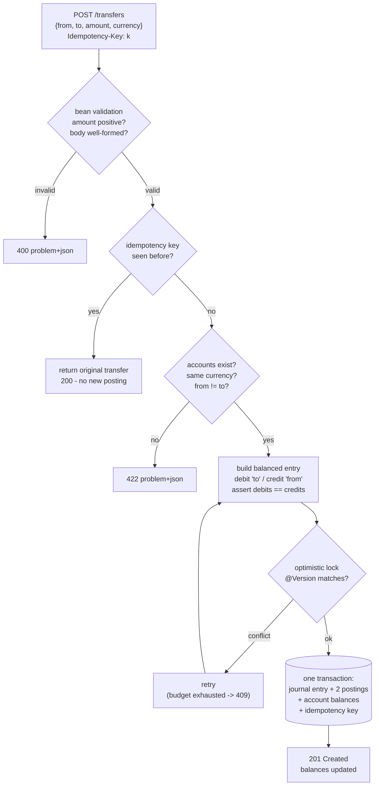

# paymentsflow

A payments microservice built on a **double-entry ledger**. Every money movement
is recorded as a balanced journal entry (total debits equal total credits), money
is stored as integer **minor units** (never floating point), transfers are
**idempotent** under a client key, and concurrent updates are made safe with JPA
**optimistic locking**. Spring Boot 3, Java 21, PostgreSQL in production and H2
in tests.

[](.github/workflows/ci.yml)
[](pom.xml)
[](pom.xml)
[](LICENSE)

---

## Why it matters

Most "move money from A to B" services treat a balance as a number they increment
and decrement. That loses the two properties a real ledger depends on:

- **Conservation** — money is never created or destroyed, only moved. A transfer
  that debits one account must credit another by the same amount, so the books
  always balance. paymentsflow enforces this as an invariant (`debits == credits`)
  before any balance is touched; an unbalanced entry can never be posted.
- **Safety under retries and concurrency** — networks retry, and many requests
  arrive at once. A naive service double-posts a retried payment and loses updates
  when two transfers hit the same account. paymentsflow makes a retry a no-op via
  an **idempotency key**, and uses an optimistic-lock **version** on each account
  so a concurrent write is retried or rejected (409) rather than silently
  overwriting another.

The result is a small but genuinely correct core: the kind of thing a payments or
accounting backend is actually judged on.

## How it works



1. **Validation.** `POST /transfers` is a bean-validated DTO: the amount must be a
   positive integer of minor units, the currency a 3-letter code, and both account
   ids present. Malformed requests get a 400 RFC-7807 problem response with the
   offending fields.
2. **Idempotency.** If an `Idempotency-Key` header is present and already recorded,
   the original transfer is returned (HTTP 200) and nothing is posted. The key is
   stored in the same transaction as the posting, so a replay either sees the
   committed result or loses the unique-key race and is resolved to the original.
3. **Double-entry posting.** A transfer becomes a `JournalEntry` of two postings:
   the destination is **debited** and the source **credited** by the same amount.
   `JournalEntry.validateBalanced()` rejects anything that is not balanced, has
   fewer than two legs, or carries a non-positive amount — before any balance
   changes. Unknown accounts, mismatched currencies, and self-transfers are
   rejected with 422.
4. **Concurrency.** Each `Account` carries a JPA `@Version`. Balances are written
   with a version check; a concurrent transfer that would overwrite another fails
   the check and is retried a bounded number of times, then returns 409. No update
   is ever lost.
5. **Persistence.** Accounts, journal entries, postings, and idempotency keys are
   committed atomically. H2 in-memory for dev/test; PostgreSQL with a Flyway-managed
   schema in production.

## Quick start

Requires Java 21 and Maven.

```bash
mvn spring-boot:run        # starts on http://localhost:8080 (H2 in-memory)
```

A full session — create accounts, fund one, make an idempotent transfer, replay
it, read balances, and reject invalid input:

```bash
# 1) Create an equity source and two asset accounts
curl -s -X POST localhost:8080/accounts -H 'Content-Type: application/json' \
  -d '{"name":"owner:equity","type":"EQUITY","currency":"USD"}'
curl -s -X POST localhost:8080/accounts -H 'Content-Type: application/json' \
  -d '{"name":"alice:checking","type":"ASSET","currency":"USD"}'
curl -s -X POST localhost:8080/accounts -H 'Content-Type: application/json' \
  -d '{"name":"bob:checking","type":"ASSET","currency":"USD"}'

# 2) Fund alice with $5,000 from equity (a balanced opening entry)
curl -s -X POST localhost:8080/transfers -H 'Content-Type: application/json' \
  -d '{"fromAccountId":1,"toAccountId":2,"amount":500000,"currency":"USD"}'

# 3) Move $1,500 alice -> bob, with an idempotency key
curl -s -X POST localhost:8080/transfers \
  -H 'Content-Type: application/json' -H 'Idempotency-Key: demo-key-001' \
  -d '{"fromAccountId":2,"toAccountId":3,"amount":150000,"currency":"USD"}'

# 4) Replay the SAME key: returns the original transfer (HTTP 200), no double-post
curl -s -X POST localhost:8080/transfers \
  -H 'Content-Type: application/json' -H 'Idempotency-Key: demo-key-001' \
  -d '{"fromAccountId":2,"toAccountId":3,"amount":150000,"currency":"USD"}'

# 5) Balances: alice 3500.00, bob 1500.00 (one posting, despite two requests)
curl -s localhost:8080/accounts/2/balance
curl -s localhost:8080/accounts/3/balance

# 6) Rejected requests
curl -s -X POST localhost:8080/transfers -H 'Content-Type: application/json' \
  -d '{"fromAccountId":2,"toAccountId":3,"amount":-5000,"currency":"USD"}'   # 400
curl -s -X POST localhost:8080/transfers -H 'Content-Type: application/json' \
  -d '{"fromAccountId":2,"toAccountId":999,"amount":5000,"currency":"USD"}'  # 422
```

Amounts are **minor units**: `150000` means `1500.00`. Money is never a decimal
on the wire or in storage.

### Switching to PostgreSQL

The default profile uses H2 so nothing external is needed. For production there is
a `postgres` profile that uses a real database and runs the Flyway migration in
`src/main/resources/db/migration`:

```bash
export DB_HOST=localhost DB_PORT=5432 DB_NAME=paymentsflow \
       DB_USER=paymentsflow DB_PASSWORD=secret
mvn spring-boot:run -Dspring-boot.run.profiles=postgres
# or against a built jar:
java -jar target/paymentsflow-0.1.0.jar --spring.profiles.active=postgres
```

Under `postgres`, Flyway owns the schema and Hibernate runs with
`ddl-auto=validate`. The test suite never touches this profile.

## API

| Method | Path                      | Purpose                                   | Success | Errors |
| ------ | ------------------------- | ----------------------------------------- | ------- | ------ |
| POST   | `/accounts`               | Create an account                         | 201     | 400 |
| GET    | `/accounts/{id}`          | Fetch an account                          | 200     | 404 |
| GET    | `/accounts/{id}/balance`  | Fetch an account's balance                | 200     | 404 |
| POST   | `/transfers`              | Post a transfer (honours `Idempotency-Key`) | 201 / 200 (replay) | 400, 409, 422 |
| GET    | `/transfers/{id}`         | Fetch a posted transfer and its postings  | 200     | 404 |
| GET    | `/actuator/health`        | Liveness / readiness                      | 200     | — |
| GET    | `/actuator/metrics`       | Micrometer metrics                        | 200     | — |

Errors are [RFC-7807](https://datatracker.ietf.org/doc/html/rfc7807)
`application/problem+json`:

```json
{
  "type": "https://paymentsflow/errors/transfer-rejected",
  "title": "Transfer rejected",
  "status": 422,
  "detail": "transfer currency EUR must match both accounts (from=USD, to=USD)",
  "instance": "/transfers",
  "code": "transfer-rejected"
}
```

| Condition                          | Status |
| ---------------------------------- | ------ |
| Malformed body / non-positive amount | 400 (`validation-failed`, with `errors[]`) |
| Account not found (`GET`)          | 404 (`account-not-found`) |
| Transfer not found (`GET`)         | 404 (`transfer-not-found`) |
| Unknown account, currency mismatch, self-transfer, unbalanced entry | 422 (`transfer-rejected`) |
| Lost optimistic-lock race after retries | 409 (`concurrency-conflict`) |

## Design

**Why integer minor units.** IEEE-754 floating point cannot represent most decimal
fractions exactly (`0.1 + 0.2 != 0.3`), so a ledger built on `double` accumulates
rounding error and a balance that should net to zero does not. Every amount here is
a `long` number of minor units; arithmetic is exact and a balanced entry balances to
the last cent. Formatting to a decimal string happens only at the API edge
(`Money.format()`), never in the maths. See ADR 0001.

**Why double-entry.** Modelling a transfer as two postings against one balanced
entry makes conservation of money a checkable invariant rather than a convention.
`debits == credits` is asserted before any balance moves, so the books cannot drift,
and the full history is auditable: every balance is the sum of its postings. See
ADR 0002.

**Why idempotency keys.** Payment clients retry on timeouts, and a retried
`POST /transfers` must not post twice. The `Idempotency-Key` header is recorded with
its journal entry in the same transaction, so a replay returns the original result
and the unique key makes a concurrent duplicate impossible. See ADR 0003.

**Why optimistic locking.** Two transfers touching the same account can interleave
and lose an update. A pessimistic lock serialises every transfer and hurts
throughput; an optimistic `@Version` lets non-conflicting transfers proceed in
parallel and only makes the rare real conflict pay — by retrying, or returning 409.
See ADR 0004.

## Testing

```bash
mvn test        # unit + integration, fully offline on H2
mvn verify      # the above, as CI runs it
```

The suite covers the balanced-entry invariant (unbalanced, single-leg, and
non-positive entries are rejected), a successful transfer updating both balances,
idempotent replay not double-posting, concurrent transfers losing no updates under
optimistic locking, the validation and problem-response paths, and an actuator
health check. It uses H2 in-memory and needs no external services; Postgres and
Flyway are never exercised by the tests.

## Documentation

- `docs/architecture.md` — components, request flow, and layering.
- `docs/adr/` — the four main design decisions and their trade-offs.
- `docs/estudio/` — a study guide in Spanish, for learning the project in depth.

## A note on scope

paymentsflow is a reference implementation of a correct ledger core, not a complete
banking platform. It deliberately leaves out authentication and multi-tenant
isolation, multi-currency transfers with FX, holds/authorizations and settlement,
reversals and period closing, and sub-minor-unit amounts. Account funding is modelled
the double-entry way — as an opening entry from an equity account — rather than by
writing a balance directly. What it does do, it does correctly: balanced postings,
exact money, idempotency, and safe concurrency.

## License

MIT. See [LICENSE](LICENSE). Copyright (c) 2026 Angelo David Padilla Romero.
