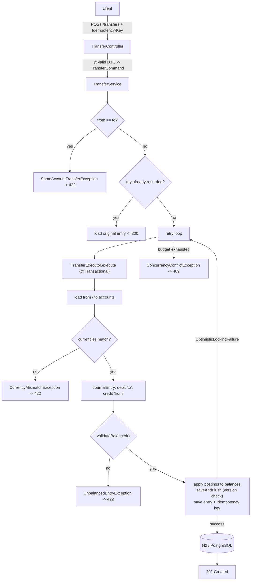

# Architecture

paymentsflow is a conventional layered Spring Boot service with a small, strict
domain at its centre. The layers are deliberately thin; the interesting logic —
the double-entry invariant, idempotency, and the optimistic-lock retry — lives in
the domain and service.

## Layers

| Layer       | Package                              | Responsibility                                               |
| ----------- | ------------------------------------ | ------------------------------------------------------------ |
| Web         | `web`, `web.dto`                     | REST controllers, request/response DTOs, RFC-7807 errors     |
| Service     | `service`                            | Orchestration: idempotency, retry loop, the posting unit of work |
| Domain      | `domain`                             | Entities and the double-entry invariant (`JournalEntry`, `Account`, `Posting`, `Money`) |
| Repository  | `repository`                         | Spring Data JPA repositories                                 |
| Config      | `config`                             | Typed configuration properties                               |
| Exception   | `exception`                          | Domain/application exceptions mapped to HTTP status          |

## Components

| Component               | Type                 | Responsibility                                                        |
| ----------------------- | -------------------- | --------------------------------------------------------------------- |
| `AccountController`     | `@RestController`    | Create / read accounts and balances                                   |
| `TransferController`    | `@RestController`    | Post transfers (idempotent) and read them                             |
| `GlobalExceptionHandler`| `@RestControllerAdvice` | Translates exceptions to `ProblemDetail`                           |
| `AccountService`        | `@Service`           | Create and read accounts                                              |
| `TransferService`       | `@Service`           | Idempotency short-circuit + optimistic-lock retry loop (not transactional) |
| `TransferExecutor`      | `@Component`         | The single transactional transfer attempt (one tx per attempt)        |
| `Account`               | `@Entity`            | Balance in minor units, `@Version` for optimistic locking             |
| `JournalEntry`          | `@Entity`            | Balanced set of postings; owns `validateBalanced()`                   |
| `Posting`               | `@Entity`            | One debit or credit leg against an account                            |
| `IdempotencyRecord`     | `@Entity`            | Maps an idempotency key to the entry it produced (key is the PK)      |
| `Money`                 | value object (record)| Integer minor units + currency; formatting at the edge only           |

## Request flow

## Why the retry loop is outside the transaction

`TransferService.transfer` is intentionally **not** `@Transactional`. Each attempt
must run in a fresh transaction with a fresh persistence context, which it gets by
calling the separate `TransferExecutor` bean through the Spring proxy. If the retry
loop shared one transaction with the executor, a failed attempt would leave the
transaction marked rollback-only and the retry could not commit. Keeping the unit
of work in its own bean is what makes "retry on optimistic-lock conflict" correct
rather than merely plausible.

## Persistence and profiles

- **Default (dev/test):** H2 in-memory in PostgreSQL compatibility mode, schema
  generated by Hibernate (`ddl-auto=create-drop`), Flyway disabled. No external
  service is required, so the whole test suite runs offline.
- **`postgres` (production):** a real PostgreSQL database, schema owned by the
  Flyway migration `V1__init.sql`, Hibernate running `ddl-auto=validate` to confirm
  the entity mapping matches the migrated schema.

The four tables — `account`, `journal_entry`, `posting`, `idempotency_record` — are
written in a single transaction per transfer, so a transfer and its idempotency key
commit together or not at all.

## Observability

Spring Boot Actuator exposes `health`, `info`, and `metrics` (Micrometer). The
health endpoint includes a database check, so a readiness probe reflects real
datasource availability.
